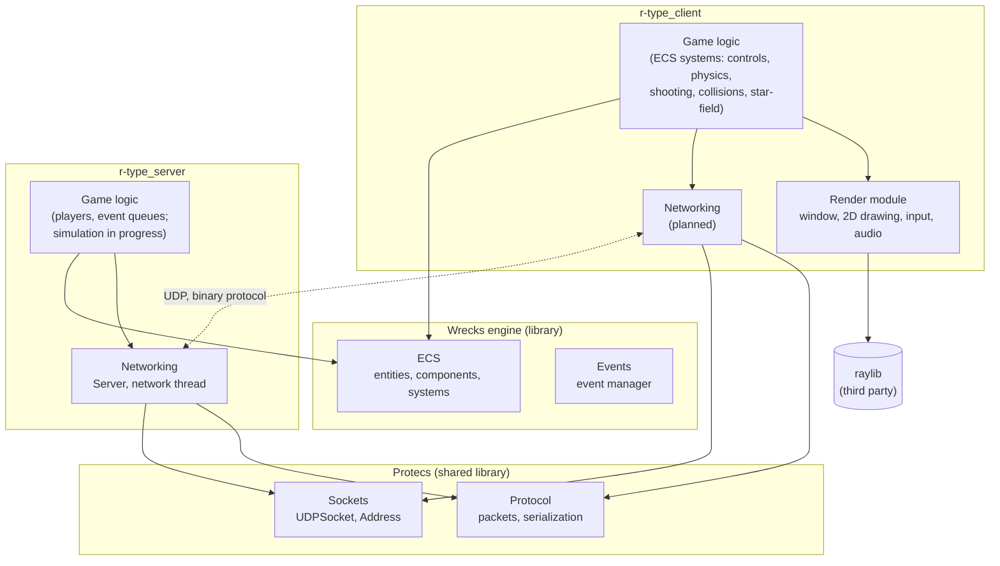
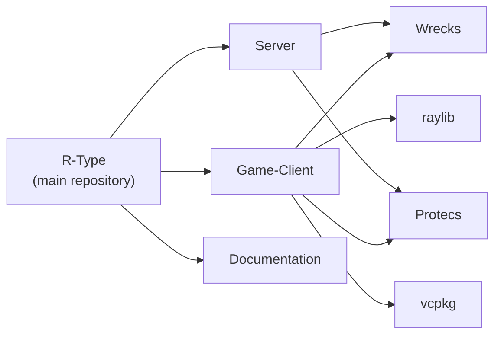

# Architecture

R-Type follows a **client / authoritative server** model: clients send the
player inputs, the server simulates the game and is the only one to decide what
happens (spawns, hits, deaths), and clients display the result.

## Layers

Both programs are built on **Wrecks**, our game-agnostic engine library, and on
**Protecs**, the library they share for everything specific to R-Type's
network (protocol, sockets, shared components). Each program keeps rendering,
networking and game logic in separate subsystems.

| Layer | Role | Where |
|---|---|---|
| Game logic | Entities and their behavior, as ECS systems | Client `src/systems`, server `src/game` (in progress) |
| Render module | Window, drawing, input and audio behind our own API: game code never includes raylib | Client `src/render` |
| Networking | Receiving and sending packets | Server `src/networking`, client (planned) |
| Protocol | Packet types, binary serialization, cross-platform UDP sockets, components shared by both programs | Protecs |
| Engine | ECS, events and utilities, with no knowledge of R-Type | Wrecks |

## Decoupling rules

- **The render module only knows how to draw.** It receives positions and
  handles (`TextureId`, `FontId`...), never game rules. Game code reaches it
  through concepts (`RendererBackend`, `InputBackend`, `AudioBackend`), so
  systems can be tested with fake implementations.
- **ECS components are plain data.** Library objects (textures, sounds) stay
  in the render module, and components only store handles to them.
- **The server has the final word.** The client may predict local movement,
  but anything that matters for the game (deaths, pickups) comes from the
  server.
- **Time is driven by clocks, not by the CPU speed.** Game loops measure
  elapsed time with `std::chrono::steady_clock`, and every speed is multiplied
  by the time elapsed since the previous frame.
- **Logic and drawing are separate stages.** Each frame runs the state systems
  (`engine.update()`), then the render systems (`engine.render()`): a render
  system only reads the state, it never changes it.

## Repositories and build

Every arrow is a git submodule. The root `CMakeLists.txt` of R-Type builds
each component as a **standalone CMake project** (`ExternalProject`): each one
keeps its own Wrecks and Protecs versions and toolchain (vcpkg for the client), which also
lets every component be developed and tested on its own.
