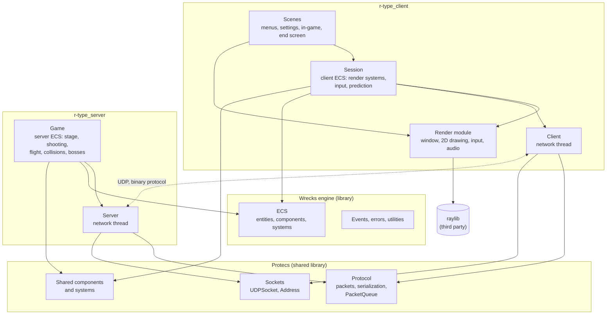
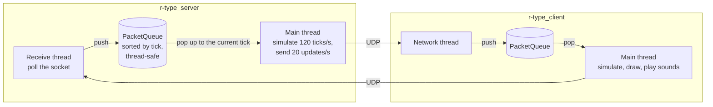
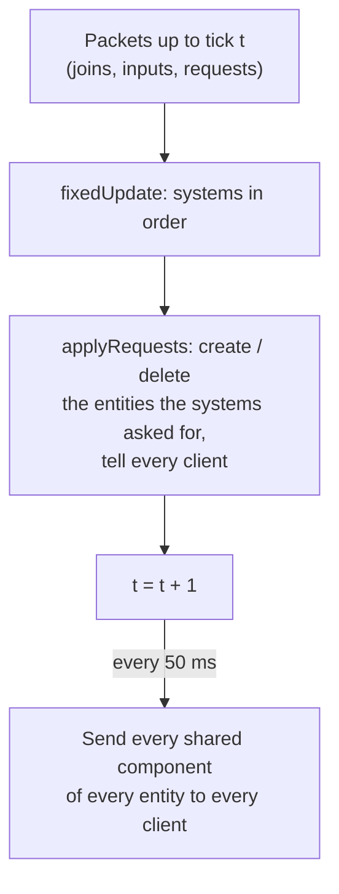
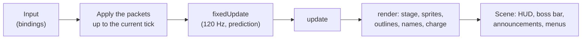
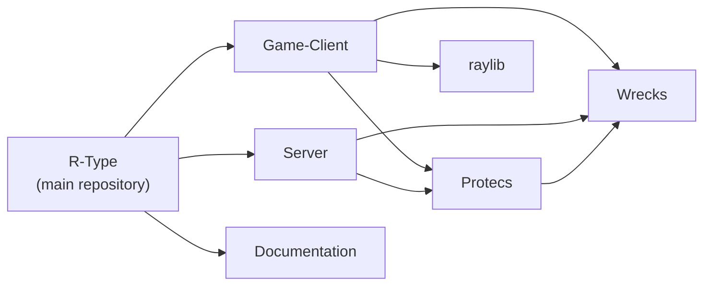

# Architecture

R-Type follows a **client / authoritative server** model: clients send the
player inputs, the server simulates the game and is the only one to decide what
happens (spawns, hits, deaths, scores), and clients display the result.

## Layers

Both programs are built on **Wrecks**, our game-agnostic engine library, and on
**Protecs**, the library they share for everything specific to R-Type's network
(protocol, sockets, shared components and systems). Each program keeps
**rendering, networking and game logic in separate subsystems**.

| Layer | Role | Where |
|---|---|---|
| Scenes | Screens of the client and the moves between them | Client `src/scenes` |
| Session | One game on the client: its ECS, the packets it applies, what it draws | Client `src/game/Session` |
| Render module | Window, drawing, input and audio behind our own API: game code never includes raylib | Client `src/render` |
| Game | The server's ECS, players, levels, and the requests of its systems | Server `src/game`, `src/systems` |
| Networking | Sending and receiving packets, on a thread of their own | Client `src/game/Client`, server `src/game/Server` |
| Protocol | Packet types, binary serialization, cross-platform UDP sockets, components and systems shared by both programs | Protecs |
| Engine | ECS, events and utilities, with no knowledge of R-Type | Wrecks |

## Threads

- The **receive threads** only read datagrams and push them into a
  thread-safe `PacketQueue`. They never touch the game state.
- The **main threads** take the packets whose tick has come, run the
  simulation, and send. The game state belongs to the main thread only, so it
  needs no lock.

## A tick on the server

Systems may not create or delete entities while Wrecks goes through them, so
they **ask** (`Game::Requests`), and the game applies the requests after each
tick. The server systems run in this order:

| Order | System | Role |
|---|---|---|
| shared | `PlayerMovement`, `Motion`, `PlayerBounds`... (Protecs) | Players move from their inputs, inside the screen |
| 40 | `Scrolling` | The level scrolls up to the end of its stage |
| 41 | `StageSpawner` | Enemies of the stage file appear, then the boss |
| 45 | `BurstFire` | Entities with `AimedBursts` fire at the nearest player |
| 50 | `Shooting` | Missiles, charged beams, enemies' random shots |
| 60 | `Flight` | Enemies, missiles and bonuses fly; they are removed off screen |
| 110 | `Collisions` | Hits, damage, scores, lives |
| 111 | `Looting` | A killed enemy may drop its `Loot` (a bonus life) |
| 112 | `Swinging` | Swinging parts (a boss tail) sweep their arc |
| 113 | `Collecting` | A player who touches or shoots a bonus takes it |
| 115 | `Attachment` | Boss parts follow their weak point, and die with it |
| 118 | `PhaseChange` | A boss whose health is low gets angry (phase 2) |
| 120 | `BossDefeat` | A killed boss clears the stage |
| 125 | `StageTransition` | Next stage, or victory after the last one |

Stages and bosses are **data**: a stage is a file
(`assets/stages/stage-<n>.waves`: length, boss, waves) and a boss is a
**blueprint**, a list of behaviour components (`Enemy`, `Armored`, `StopAt`,
`Attached`, `Swing`, `AimedBursts`, `Enrage`, `Boss`...) run by the generic systems above. Adding
a stage needs no code. See the [server](systems/server.md).

## A frame on the client

The client systems are `PlayerInput`, `ChargeTimer` (state) and `RenderStage`,
`RenderSprite`, `RenderOutline`, `RenderName`, `RenderCharge` (drawing, in this
order). See the [client](systems/client.md).

## Decoupling rules

- **The render module only knows how to draw.** It receives positions and
  handles (`TextureId`, `SoundId`...), never game rules. Game code reaches it
  through concepts (`RendererBackend`, `InputBackend`, `AudioBackend`), so
  systems are tested with fake implementations.
- **ECS components are plain data.** Library objects (textures, sounds) stay in
  the render module, and components only store handles to them.
- **The server has the final word.** The client may predict its own movement,
  but anything that matters for the game (hits, deaths, scores) comes from the
  server.
- **Time is driven by clocks, not by the CPU speed.** Both programs measure
  the elapsed time with `std::chrono::steady_clock` and run the simulation at a
  fixed 120 ticks per second, whatever the frame rate.
- **Logic and drawing are separate stages.** Each frame runs the state systems,
  then the render systems: a render system only reads the state.
- **Wrecks knows nothing about R-Type.** Everything specific to the game lives
  in Protecs, the client or the server.

## Repositories and build

Every arrow is a git submodule, pinned to a commit. The root `CMakeLists.txt`
of R-Type builds each component as a **standalone CMake project**: each one
keeps its own Wrecks and Protecs versions, which also lets every component be
developed and tested on its own.

**Continuous integration** (GitHub Actions) builds every pull request on Linux
(GCC 14) and Windows (MSVC): Wrecks and Protecs run their unit tests, the client
runs its unit tests, the server is built. Compiled dependencies are cached
between runs.
