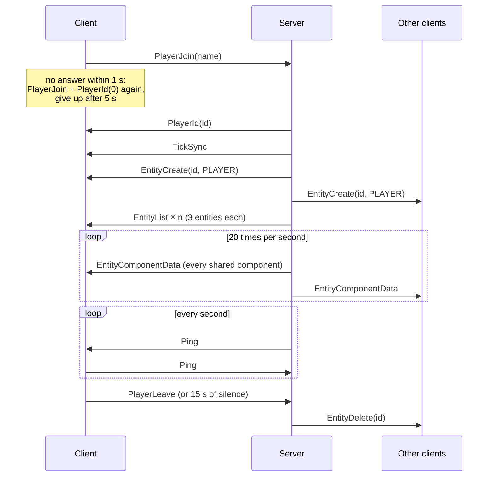

# Network protocol

**Status:** version 1, implemented by `r-type_server` and `r-type_client`
(library [Protecs](systems/protecs.md)). This document is meant to be complete
enough to write a new client, in any language, without reading our code.

!!! info "Classic RFC format"
    The same specification is available as a classic RFC text document
    (plain text, 72 columns, paginated, with packet diagrams):
    [**RFC 9999 — R-Type Game Protocol**](rfc-rtype.txt). Update both when
    the protocol changes.

The key words **MUST**, **MUST NOT**, **SHOULD**, **SHOULD NOT** and **MAY** are
to be interpreted as described in
[RFC 2119](https://www.rfc-editor.org/rfc/rfc2119).

## 1. Overview

- The server is **authoritative**: it simulates the game, and clients only
  send the player's inputs and display what the server describes.
- The game state is a set of **entities** (players, enemies, missiles, the
  level...). Each entity has **components** (position, health, score...).
  The server replicates the *shared* components of every entity to every
  client.
- Both sides run the game at a fixed **simulation rate of 120 ticks per
  second**. Most packets carry the **simulation tick** they apply to, so a
  receiver can apply them in order, at the right moment.

## 2. Transport

- All communication uses **UDP**. There is no TCP connection: a lost or late
  game update is worthless once the next one is sent, and UDP lets the game
  go on without waiting for retransmissions.
- The server listens on **UDP port 5432**, on every interface (`0.0.0.0`).
  A client uses any local port; the server answers to the address and port
  the datagram came from.
- One datagram carries exactly **one packet**.
- A datagram MUST NOT be longer than **64 bytes**. Receivers read at most
  64 bytes per datagram: a longer one is truncated, and then usually rejected
  as malformed.
- UDP does not guarantee delivery, order or uniqueness. A peer MUST NOT assume
  that a packet arrives, arrives once, or arrives in order. Section 7 explains
  how the protocol copes with it.

## 3. Data types

| Type | Size | Encoding |
|---|---|---|
| `u8` | 1 byte | unsigned integer |
| `u16` | 2 bytes | unsigned integer, little-endian |
| `u32` | 4 bytes | unsigned integer, little-endian |
| `u64` | 8 bytes | unsigned integer, little-endian |
| `i64` | 8 bytes | signed integer (two's complement), little-endian |
| `f32` | 4 bytes | IEEE 754 single precision float, little-endian |
| `bool` | 1 byte | `0` is false, any other value is true |
| `bits64` | 8 bytes | 64 flags: flag `i` is bit `i % 8` (least significant first) of byte `i / 8` |
| `str32` | 1 to 33 bytes | `u8` length (0 to 32), then that many bytes of text, no terminator |

- All multi-byte values are **little-endian**. A peer running on a big-endian
  machine MUST swap the bytes.
- Fields are **packed**: there is no padding between them, and a packet is
  exactly as long as its fields (no trailing bytes).
- `tick` is a `u32` simulation tick. `id` is a `u64` **network entity id**
  (section 6.1).

## 4. Packet layout

```text
 0                   1                   2
 0 1 2 3 4 5 6 7 8 9 0 1 2 3 4 5 6 7 8 9 0 1 2 3 ...
+---------------+-----------------------------------------
|     type      |  payload (depends on the type, 0 to 63 bytes)
+---------------+-----------------------------------------
```

| Offset | Size | Field |
|---|---|---|
| 0 | 1 | `type`: packet type, a `u8` from the table below |
| 1 | depends on the type | `payload` |

| Type | Name | Direction | Size on the wire | Has a tick |
|---|---|---|---|---|
| 0 | `EntityComponentData` | server → client | 15 + component | yes |
| 1 | `EntityCreate` | server → client | 14 | yes |
| 2 | `EntityDelete` | server → client | 13 | yes |
| 3 | `EntityList` | both | 9 + 16 per entity | yes |
| 4 | `EntityRemoveComponent` | server → client | 15 | yes |
| 5 | `EntitySyncComponents` | both | 21 | yes |
| 6 | `Ping` | both | 1 | no |
| 7 | `PlayerId` | both | 9 | no |
| 8 | `PlayerInput` | both | 8 | yes |
| 9 | `PlayerJoin` | client → server | 2 to 34 | no |
| 10 | `PlayerLeave` | both | 1 | no |
| 11 | `TickSync` | both | 25 | no |

Sizes are measured by the [benchmarks](technical-study.md#measurements) (`rtype_bench sizes`).

## 5. Packets

### 5.1 `EntityComponentData` (type 0)

The value of one shared component of an entity. The server sends one for
every shared component of every entity, 20 times per second.

| Offset | Size | Field | Description |
|---|---|---|---|
| 1 | 4 | `tick` | Tick of the value |
| 5 | 8 | `id` | Entity |
| 13 | 2 | `component` | `u16` component type (section 6.3) |
| 15 | depends | `data` | Component value (section 6.3) |

A receiver that does not know `id` SHOULD ask for the entity list
(section 7.3) and drop the packet.

### 5.2 `EntityCreate` (type 1)

| Offset | Size | Field | Description |
|---|---|---|---|
| 1 | 4 | `tick` | Tick of the creation |
| 5 | 8 | `id` | New entity |
| 13 | 1 | `kind` | `u8` entity kind (section 6.2): what to draw |

The components of the entity follow as `EntityComponentData` packets.

### 5.3 `EntityDelete` (type 2)

| Offset | Size | Field | Description |
|---|---|---|---|
| 1 | 4 | `tick` | Tick of the deletion; `0` means "now" |
| 5 | 8 | `id` | Deleted entity |

The receiver removes the entity and its components. A client SHOULD show the
death of an enemy or a player (explosion) when its entity is deleted.

### 5.4 `EntityList` (type 3)

| Offset | Size | Field | Description |
|---|---|---|---|
| 1 | 4 | `tick` | Tick of the list |
| 5 | 4 | `count` | `u32` number of entries |
| 9 | 16 × `count` | entries | For each entity: `id` (`u64`), then its shared components (`bits64`, flag `i` set when it has component type `i`) |

- **Client → server**: a request for the list. The client sends it with
  `count = 0` (9 bytes).
- **Server → client**: the list of every entity. It does not fit in one
  datagram (64 bytes hold **3 entries**), so the server sends as many
  `EntityList` packets as needed, each with at most 3 entries. A receiver
  MUST handle each packet on its own, and MUST NOT expect them all to arrive.
- A receiver MUST reject a packet whose `count` needs more bytes than the
  datagram has.

### 5.5 `EntityRemoveComponent` (type 4)

| Offset | Size | Field | Description |
|---|---|---|---|
| 1 | 4 | `tick` | Tick of the removal |
| 5 | 8 | `id` | Entity |
| 13 | 2 | `component` | `u16` component type to remove |

### 5.6 `EntitySyncComponents` (type 5)

| Offset | Size | Field | Description |
|---|---|---|---|
| 1 | 4 | `tick` | Tick |
| 5 | 8 | `id` | Entity |
| 13 | 8 | `components` | `bits64`: the shared components the sender has for this entity |

- **Client → server**: "this is what I have for this entity".
- **Server → client**: the server's own set, followed by an
  `EntityComponentData` for each component the client lacks and an
  `EntityRemoveComponent` for each one it should not have (section 7.3).

### 5.7 `Ping` (type 6)

No payload. The server sends one to every player **every second**, and a
client MUST answer it with a `Ping`. A player the server has heard nothing from
(no `Ping`, no other packet) for **15 seconds** is considered gone (section 7.1).

### 5.8 `PlayerId` (type 7)

| Offset | Size | Field | Description |
|---|---|---|---|
| 1 | 8 | `id` | Network id of the player's own entity |

- **Server → client**: answer to a join. `id = 0` means the server refused the
  player.
- **Client → server**: "I lost my id": the server sends the `PlayerId` again
  (the client's own `id` field is ignored, it SHOULD be `0`). The server
  ignores it from an address that did not join.

### 5.9 `PlayerInput` (type 8)

| Offset | Size | Field | Description |
|---|---|---|---|
| 1 | 4 | `tick` | Tick the input applies to (in the server's time, section 7.2) |
| 5 | 1 | `sequence` | `u8` order of the inputs sent for the same tick |
| 6 | 1 | `input` | `0` up, `1` down, `2` left, `3` right, `4` fire |
| 7 | 1 | `state` | `0` pressed (held down), `1` released |

- **Client → server**: a change of one input of the player.
- **Server → client**: a request for the full input state: the server sends
  an empty one (all fields `0`) every 0.5 s. The client answers with five
  `PlayerInput` packets for the same tick, `sequence` 0 to 4, one per input
  (up, down, left, right, fire), with the state it holds now. A lost press or
  release is thus corrected within half a second.

The server ignores an input for a tick it already simulated. Holding fire
charges the shot; releasing it fires (section 6.4).

### 5.10 `PlayerJoin` (type 9)

| Offset | Size | Field | Description |
|---|---|---|---|
| 1 | 1 to 33 | `name` | `str32`: the player's name |

The first packet of a client (section 7.1). A name longer than 32 bytes MUST be
rejected. The server ignores a `PlayerJoin` from an address that already joined.

### 5.11 `PlayerLeave` (type 10)

No payload.

- **Client → server**: the player quits. The server deletes its entity and tells
  the other clients (`EntityDelete`).
- **Server → client**: the client was removed from the game and SHOULD end its
  session.

### 5.12 `TickSync` (type 11)

| Offset | Size | Field | Description |
|---|---|---|---|
| 1 | 4 | `clientTick` | `u32` client's tick when it sent the request |
| 5 | 4 | `serverTick` | `u32` server's tick when it answered (0 in a request) |
| 9 | 8 | `clientTime` | `i64` client's clock when it sent the request, opaque to the server |
| 17 | 8 | `serverTime` | `i64` server's monotonic clock in nanoseconds when it answered |

The client sends it with its own values, and the server sends it back with
`clientTick` and `clientTime` unchanged (section 7.2). The server also sends one
right after a join.

## 6. Game data

### 6.1 Entities and ids

- Entity ids are chosen by the server. A client MUST treat them as opaque
  `u64` values and MUST NOT assume that ids are small or consecutive (the
  reference server mixes a time stamp in the upper 32 bits, so an id is not
  reused when an entity slot is).
- The value `0` is never a valid entity; `PlayerId` uses it for "refused".

### 6.2 Entity kinds (`EntityCreate.kind`)

| Kind | Name | Meaning |
|---|---|---|
| 0 | `GENERIC` | Nothing to draw. The **level** is such an entity (component `Level`) |
| 1 | `PLAYER` | A player's ship, coloured by `PlayerStats.slot` |
| 2 | `ENEMY_PATA_PATA` | Small enemy flying in waves |
| 3 | `ENEMY_SCANT` | Enemy |
| 4 | `PLAYER_MISSILE` | Missile shot by a player |
| 5 | `ENEMY_MISSILE` | Missile shot by an enemy or a boss |
| 6 to 10 | `PLAYER_BEAM_1` to `PLAYER_BEAM_5` | Charged beam of a player, by charge level (1 to 5) |
| 11 | `ENEMY_DOBKERATOPS` | Stage 1 boss: its body (armored, it does not take damage) |
| 12 | `ENEMY_DOBKERATOPS_CORE` | Stage 1 boss: its weak point. Its `Health` is the boss health; its deletion is the boss death |
| 13 | `ENEMY_DOBKERATOPS_TAIL` | Stage 1 boss: a segment of its tail, sweeping the screen; armored, it hurts on contact |
| 14 | `PICKUP_LIFE` | Bonus life dropped by a killed enemy, drifting left: the player who touches it, or shoots it, gets one more life |

New kinds are added at the end: existing values never change.

### 6.3 Components

The world is **800 × 450 units**; `x` grows to the right and `y` downwards.
Component types are the index of the component in this table:

| Type | Component | Size | Fields |
|---|---|---|---|
| 0 | `Level` | 6 | `progression` `u32` (pixels of the stage background scrolled), `stage` `u8` (1 to 8), `won` `bool` (the last stage is cleared: the game is won) |
| 1 | `Movement` | 12 | `direction` 2 × `f32`, `speed` `f32` |
| 2 | `PathFinding` | 13 | `type` `u8` (`0` straight), `targetVelocity` 2 × `f32`, `acceleration` `f32` |
| 3 | `PlayerInput` | 1 | `u8` flags: bit 4 up, bit 3 down, bit 2 left, bit 1 right, bit 0 fire |
| 4 | `PlayerStats` | 7 | `slot` `u8` (0 to 3, the player's colour), `lives` `u8` (0: out of the game), `score` `u32`, `charge` `u8` (0 to 5, charge level while fire is held) |
| 5 | `Transform` | 16 | `position` 2 × `f32` (top-left corner), `rotation` `f32`, `scale` `f32` (draw the sprite that much bigger) |
| 6 | `Velocity` | 12 | `position` 2 × `f32` (units per tick), `angular` `f32` |
| 7 | `PlayerName` | 1 to 33 | `str32`: the player's name |
| 8 | `Health` | 4 | `hp` `u16`, `max` `u16` |
| 9 | `BossPhase` | 1 | `phase` `u8`: 1 when a boss comes, 2 once it gets angry |

New components are added at the end: existing types never change. The server
sends every component of every entity 20 times per second, except
`PlayerInput`.

### 6.4 Gameplay the client shows

- **Players**: `PlayerStats.lives` hearts, `score`, and `charge` while the
  player charges. At `lives = 0` the player is out: the others play on. A
  larger `lives` is a bonus life taken (`PICKUP_LIFE`); lives stop at 10.
- **Charged shot**: tap fire for a missile; hold it to charge (one level per
  0.4 s, up to 5), release to fire a beam (`PLAYER_BEAM_n`).
- **Level**: one `GENERIC` entity with `Level`. A change of `stage` starts a
  new stage; `won = true` ends the game with a victory.
- **Boss**: `Health` of the `ENEMY_DOBKERATOPS_CORE` entity is the boss health. When its
  `BossPhase` goes up, the boss gets angry: a client SHOULD show it (text, sound, flash).

## 7. Behaviour

### 7.1 Joining and leaving



1. The client sends `PlayerJoin`. Without an answer within a second, it sends
   `PlayerJoin` again with a `PlayerId` (in case the server's answer was lost),
   and gives up after 5 seconds.
2. The server registers the address, answers `PlayerId`, `TickSync`, announces
   the new player to everyone (`EntityCreate`), and sends the entity list. The
   first player to join starts the level; when the last player leaves, the
   server deletes every entity and the level starts over with the next player.
3. To quit, the client sends `PlayerLeave`.
4. If a client crashes or loses its connection, it stops answering. The server
   removes a player it has received nothing from for 15 seconds, exactly as if
   it had sent `PlayerLeave`: the other clients get its `EntityDelete`, and the
   game goes on.

### 7.2 Ticks and clock synchronization

- Both sides count ticks at 120 per second, from their own start. The
  difference between the server's tick and the client's is measured with
  `TickSync`: the client sends one about every 100 ticks; with the answer,
  the round trip time is `now - clientTime`, and the server's current tick is
  about `serverTick + (round trip / 2) × 120`.
- A client MUST stamp its `PlayerInput` with a tick in the **server's** time,
  slightly ahead of it, so the input reaches the server before that tick is
  simulated.
- A receiver queues packets that have a tick and applies them when its
  simulation reaches that tick. Packets without a tick, and packets with
  tick `0`, are applied at once.

### 7.3 Staying consistent over a lossy network

UDP may lose any packet. The protocol never retransmits; it **repeats state**
instead:

- **Component values** are sent 20 times per second: a lost value is replaced
  50 ms later.
- **Inputs** are re-sent in full every 0.5 s on the server's request
  (section 5.9).
- **A lost `EntityCreate`**: the client receives data for an entity it does
  not know, and asks for the entity list (`EntityList` with `count = 0`).
  For an entity whose components differ, it sends `EntitySyncComponents`, and
  the server answers with the missing or extra components.
- **A lost `EntityDelete`**: a client SHOULD forget an entity the server has
  not updated for one second while other updates keep arriving (the server
  updates every entity 20 times per second). The reference client does so.
  [Measured](technical-study.md#packet-loss): with 20 % of the datagrams lost,
  this removes about 92 % of the entities that would otherwise stay on screen
  after their deletion.

### 7.4 Example exchange

Alice joins, the server gives her the id `0x1a2b3c4d00000007`, she holds fire,
and an enemy dies. Bytes in hexadecimal, as sent on the wire:

| Direction | Packet | Bytes |
|---|---|---|
| client → server | `PlayerJoin("alice")` | `09` `05` `61 6c 69 63 65` |
| server → client | `PlayerId(0x1a2b3c4d00000007)` | `07` `07 00 00 00 4d 3c 2b 1a` |
| server → client | `EntityComponentData`, tick 1000, her `Transform`: position (123.5, 67.25), rotation 0, scale 1 | `00` `e8 03 00 00` `07 00 00 00 4d 3c 2b 1a` `05 00` `00 00 f7 42` `00 80 86 42` `00 00 00 00` `00 00 80 3f` |
| client → server | `PlayerInput`, tick 1012, sequence 0, fire, pressed | `08` `f4 03 00 00` `00` `04` `00` |
| server → client | `EntityDelete`, tick 0 (now), entity `0x1a2b3c4d00000009` | `02` `00 00 00 00` `09 00 00 00 4d 3c 2b 1a` |

### 7.5 Why no acknowledgements

The protocol has **no sequence numbers, acknowledgements or retransmissions**.
Everything the server sends is either repeated anyway (component values, 20
times per second; inputs, on request every 0.5 s) or can be recovered on demand
(the entity list). A retransmitted packet would arrive later than the next
repetition, so acknowledgements would only add traffic and delay. Events that
must not be missed are deduced from the state: a death is the deletion of an
entity, a lost life is a smaller `PlayerStats.lives`, a victory is
`Level.won`.

## 8. Validation and security

A peer receives datagrams from anyone. Before using a packet, a receiver
**MUST**:

1. Reject an empty datagram, and read at most 64 bytes.
2. Reject an unknown `type` (12 or more).
3. Check that the datagram holds the fixed fields of the type **before reading
   them**, then that it holds every variable part: `str32` lengths (at most 32)
   and the `EntityList` `count` (16 bytes per entry).
4. Reject an unknown component type (10 or more) in `EntityComponentData`.
5. Treat a packet that fails a check as if it never arrived: drop it, keep
   running, keep no state about it.

The server **MUST** also:

- Ignore every packet but `PlayerJoin` from an address that did not join.
- Ignore inputs for ticks already simulated, and keep a bounded number of
  pending inputs per player (the reference server keeps 50).
- Never trust a client for anything but its inputs: positions, hits, scores and
  deaths are computed by the server.

[Measured](technical-study.md#security): 100 000 malformed datagrams of five
kinds (random bytes, random payload of a known type, `EntityList` announcing
4 billion entries, `PlayerJoin` with a 255-byte name, unknown component type)
did not crash the reference server, which still answered a new player in under
a millisecond.
