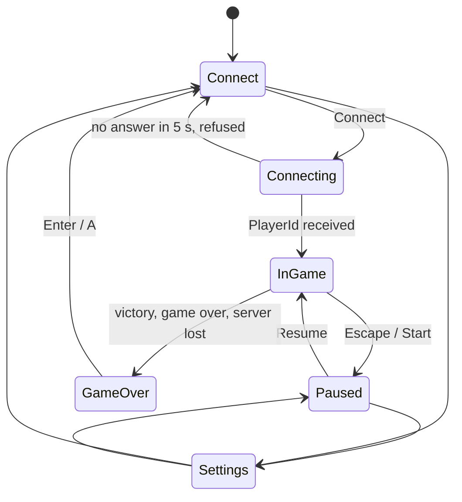

# Client

`r-type_client` shows the game the server runs and sends the player's inputs.
It never decides what happens: hits, deaths and scores come from the server.
Repository: [Space-Type/Game-Client](https://github.com/Space-Type/Game-Client).

## Layout

```text
Game-Client/
  src/main.cpp             entry point: --help, -h -p -n, then Game
  src/game/Game/           main loop, window, resources, scenes
  src/game/Client/         connection to the server, network thread
  src/game/Session/        one game: ECS engine, packets applied, sounds, announcements
  src/game/SpriteSheets/   which sprite and animation for each entity kind
  src/game/Controls/       game actions and their bindings
  src/game/Preferences/    settings file
  src/game/Starfield/      scrolling stars
  src/scenes/              Connect, Connecting, InGame, Paused, Settings, GameOver
  src/ui/                  widgets (Button, Slider, Checkbox, TextField), HUD, theme
  src/components/          client components (sprite, kind, blink, charge)
  src/systems/             client systems, listed in Tuple.hpp
  src/render/              render module: window, drawing, input, audio
  assets/                  sprites, stage backgrounds, sounds, font
  tests/                   unit tests (headless)
  lib/                     submodules: wrecks, protecs, raylib
```

## Main loop and scenes

`RType::Game::Game` owns the window, the render resources, the audio, the
controls and the scenes, and runs at up to 120 frames per second. Each frame:

1. Measure the time elapsed since the previous frame (`std::chrono::steady_clock`).
2. Update the **session** if a game is running (section below), then the
   current **scene**.
3. Draw the session, then the scene over it.



## Session

A `Session` is one game, from the connection to the end screen:

- The `Client` sends `PlayerJoin`, waits for `PlayerId`, then receives on a
  **network thread** that pushes the packets into a `PacketQueue`.
- The session applies the packets up to its current tick: it creates and
  deletes entities, and copies the shared components the server sends. A
  server entity id is mapped to a local entity (`EntityMap`).
- It keeps its tick in step with the server's (`TickSync` every 100 ticks), and
  stamps the inputs with the server's tick.
- It plays the sounds (shots, explosions, charge, level, stage clear), starts
  the explosions and blinks, and shows the **announcements** ("LEVEL n",
  "STAGE CLEAR" with the scores).
- It ends with an outcome: **victory** (`Level::won`), **defeat** (no life
  left, the others play on) or a message (connection lost).
- Entities the server stopped updating for one second are forgotten, so a lost
  `EntityDelete` does not leave a ghost on screen
  ([measured](../technical-study.md#packet-loss)).

## Systems

| Order | System | Stage | Role |
|---|---|---|---|
| shared | `PlayerMovement`, `Motion`... (Protecs) | fixed update | Local movement of the player's ship, corrected by the server |
| 0 | `PlayerInput` | update | Reads the bindings, sends a `PlayerInput` packet on each change |
| 1 | `ChargeTimer` | update | Charge level shown while Shoot is held |
| 0 | `RenderStage` | render | Stage background, scrolled with `Level::progression`; its black is transparent, so the stars only show in open space |
| 1 | `RenderSprite` | render | Sprites, animations, ship tilt, blinking |
| 2 | `RenderOutline` | render | High contrast outlines (option) |
| 3 | `RenderName` | render | Player names above the ships |
| 4 | `RenderCharge` | render | Charge animation in front of the ship |

The **HUD** (`src/ui/Hud`) is drawn by the `InGame` scene over the systems: one
line per player (name, hearts, score), the boss health bar, and the
announcements.

## Screen and world

The server's world is 800 × 450 units. The client draws it in a **virtual
resolution of 1280 × 720** (1.6 pixels per unit), scaled and letterboxed into
the real window, so the game looks the same in any window and in fullscreen.

## Controls

`src/game/Controls` defines the game actions (`Up`, `Down`, `Left`, `Right`,
`Shoot`) and their defaults: arrows and Space on the keyboard, D-pad, left
stick and A on a gamepad. Each action has one keyboard / mouse slot and one
gamepad slot, changed in **Settings > Controls** and saved in the settings
file. See [Accessibility](../accessibility.md).

## Assets

`RType::Render::assetPath("sounds/enemy_hit.wav")` returns the path of a file of
the `assets/` folder, searched next to the executable, then in its parent and
grandparent folders (`build/`, `build/Release/`). The client therefore works
whatever its working directory.

## Render module

The render module (`src/render`, namespace `RType::Render`) wraps raylib behind
our own API. Game code includes `<rtype/render.hpp>` and never `raylib.h`.

| Class | Role |
|---|---|
| `Window` | The game window. Everything is drawn in a fixed **virtual resolution**, then scaled and letterboxed into the real window |
| `Resources` | Loads textures (optionally with one colour made transparent) and fonts, caches them by path and returns **handles** (`TextureId`, `FontId`) |
| `Renderer` | Draws sprites (sprite-sheet frames, pivot, rotation, flip, tint), scrolling backgrounds, shapes and text |
| `Input` | Keyboard, mouse (in virtual coordinates) and gamepad |
| `ActionMap<Action>` | Binds game actions to keys, buttons and axes, remappable at runtime |
| `Audio` | Sounds and streamed music, with master, music and effects volumes |

Key rules:

- ECS components store **handles**, never raylib objects, so they can be
  copied and moved freely by the ECS containers.
- Only one `Window` and one `Audio` may exist at a time. Unknown handles are
  ignored, and without an audio device every audio call is a silent no-op.
- The module never paces time: the game loop does.

The full guide, with code examples, is in the client repository:
[`src/render/README.md`](https://github.com/Space-Type/Game-Client/blob/main/src/render/README.md).

## Build and test

```sh
cmake -S . -B build && cmake --build build --parallel

cmake -DCMAKE_BUILD_TYPE=DebugTests -S . -B build-tests
cmake --build build-tests --parallel
ctest --test-dir build-tests --output-on-failure
```

The unit tests (HUD, settings, controls, charge, stage view, widgets, colour
contrast...) never open a window or an audio device, so they run in CI on Linux
and Windows. A manual test program (`render_manual_test` target) checks
rendering, input and audio by eye.
